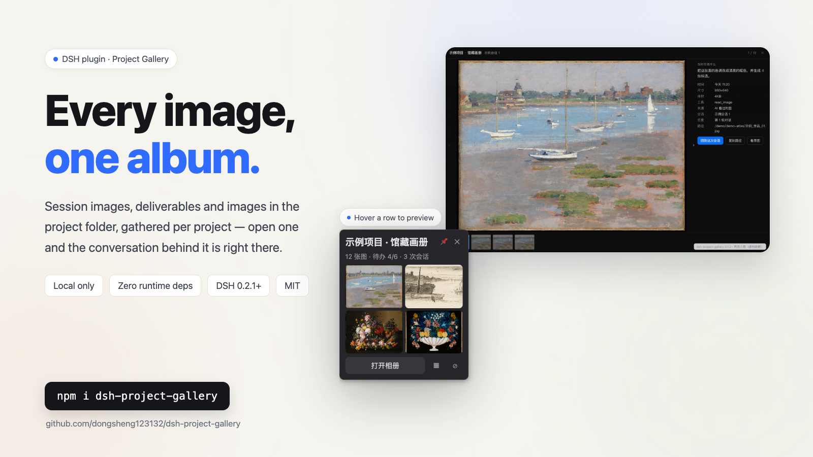
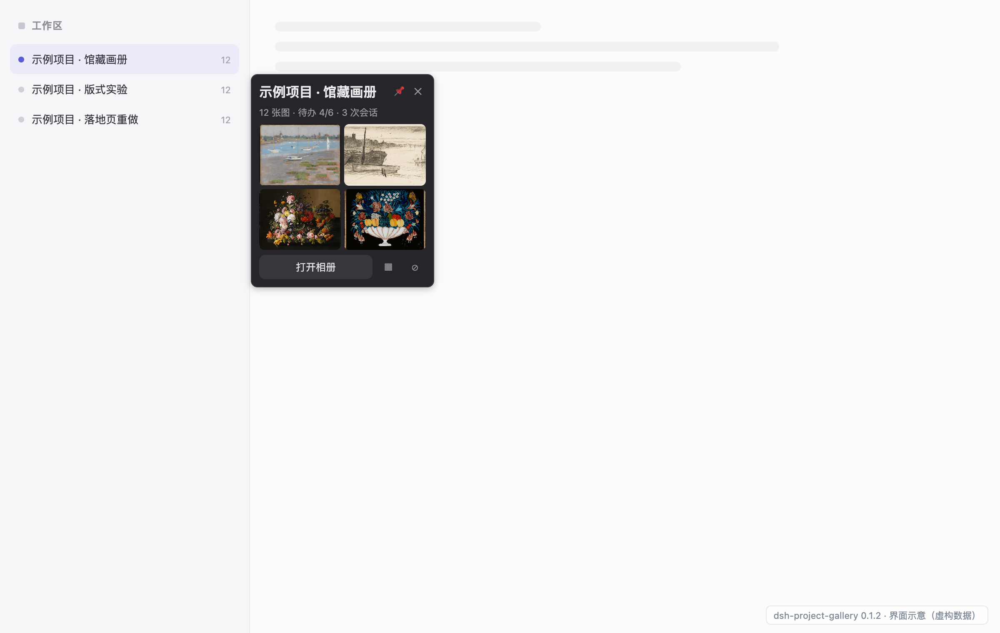
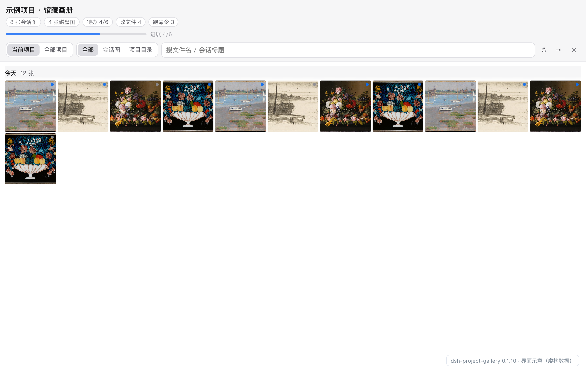

# Project Gallery · dsh-project-gallery

<p align="center">
  <a href="https://www.npmjs.com/package/dsh-project-gallery"></a>
  <a href="https://www.npmjs.com/package/dsh-project-gallery"></a>
  
  
</p>

**English** · [中文](README.md)

A DeepSeek Harness (DSH) plugin that gathers the images a project has been working with — session attachments
the AI read or produced, plus images in the project directory — into **one album per project**. Hover a project
row for the latest few; open the album; open an image and see **what you asked for at the time**.



> The interface is currently Chinese-only; this English page documents it. Screenshots use **fictional data**
> (`node demo/shots.mjs`, `node promotion/make-promo.mjs`); the demo images are public-domain artworks (Met Open
> Access, CC0 — see [demo/fixtures/LICENSE-IMAGES.md](https://github.com/dongsheng123132/dsh-project-gallery/blob/main/demo/fixtures/LICENSE-IMAGES.md)).

## Four entry points

| Where | What opens |
|---|---|
| Hover a project / chat row, then its **⋯ area on the right** | A small card: project name, "N images · todos x/y", 2×2 thumbnails; can be 📌 pinned, and a project can be ⊘ muted |
| "Open album" in the card, or click a thumbnail | Right-side panel (420px): day-grouped grid, search, session-images / on-disk-images switch |
| **📷** in the workspace header, or **⌘⇧G** | Global album overlay: projects on the left, day-grouped grid on the right |
| **"Project album" tab in the right sidebar** | A resident right pane: images filtered by scope, plus a todo progress bar |



## Three scopes

The right pane defaults to whichever context is known:

| Scope | What it shows |
|---|---|
| **This conversation** | Only images from the current session |
| **This project** | Images the project used plus images inside its folder |
| **All projects** | The latest images across projects, grouped by day, or switched to a **project board** |

The second row ("All / Session / Project folder") filters by **source**: session images come from
`~/.dsh/sessions` and the attachment store; "Project folder" scans **only the current project directory**
(depth 3, skipping `node_modules/.git/dist`, last 240 days, ≤30MB each) — it is not a whole-disk image search.

## Lightbox

The image does not take over the screen: image on the left, context on the right (what was being done, time,
dimensions, size, tool, source, session, turn number, path), that session's images as a filmstrip at the bottom.
`←/→` to page, `Esc` to step back. A 1600px rendition opens instantly; "view original" loads the full pixels.



## Where the data comes from

- Session attachments: `~/.dsh/sessions/**/session.v4.jsonl.zstd` + `~/.dsh/attachments/v1/objects/**`
- Delivered images: `deliverables/presented`
- Images in project directories: depth 3, skipping `node_modules/.git/dist`, last 240 days, 30MB per file

**Everything is read from local files; no network requests** other than the plugin's own local endpoint.

## Privacy

- The index and thumbnail cache live locally (default `~/.dsh/cache/dsh-session-gallery`) and contain **project
  paths, session titles and conversation text**; check that directory before sharing it.
- Mute settings live in browser localStorage (`dsh-project-gallery:muted`); they are not uploaded.
- No telemetry.

## Install

DSH desktop: **Settings → Plugins → Add plugin**, then enter `dsh-project-gallery`.

```sh
dsh plugin --profile web add dsh-project-gallery
# desktop app: swap web for desktop (--profile desktop)
# or track main instead of npm:
dsh plugin --profile web add github:dongsheng123132/dsh-project-gallery
```

Restart DSH afterwards. The entry point sits in the left tool area (position varies slightly by DSH version).

## Found in the plugin market

This repository's root `plugin-index.json` is a plugin-market index source:

```
https://raw.githubusercontent.com/dongsheng123132/dsh-project-gallery/main/plugin-index.json
```

Enable the experimental plugin market in DSH, add that URL as an index source, then search "Project Gallery".

## How tightly it is coupled to the host

It registers a `/session-gallery` prefix route, reads the host workspace registry, and does hover geometry on the
sidebar DOM. Whatever the host lacks degrades on its own: no registry → hover preview stops but the global album
still works; no `connection` service → the auth hook is skipped while the same-origin check stays. See
[COMPATIBILITY.md](COMPATIBILITY.md) for the host evaluator table (0.2.1-rc.5 → 0.3.0 all accepted) and the exact
failure modes. `engines.dsh` declares a lower bound only — an upper bound would make the next DSH release refuse
installation instead of degrading.

## Development

```sh
npm run check                                    # syntax + 26 unit tests (6 host-half degradation cases)
npm run bench                                    # resource baseline: index build, refresh cost, memory (PERF.md)
node scripts/compat-gate.mjs <dsh install dir>   # host's own compatibility evaluator
npm run shots                                    # regenerate the demo screenshots (needs playwright)
```

## Known limits

- Hover preview depends on host DOM (`data-row-key`) and geometry inference; a major DSH upgrade may need
  re-alignment. When it cannot find rows, only the 📷 global album remains.
- Session rows inside search results have no `data-row-key`; hover does not apply there — use the global album.
- The same image in several sessions keeps one association per session (this reflects the real state; no cross-session merge).
- Only measured on macOS so far (CLI 0.2.2-rc.1 / desktop 0.2.2-rc.3); Windows desktop is unverified.

## License

MIT
