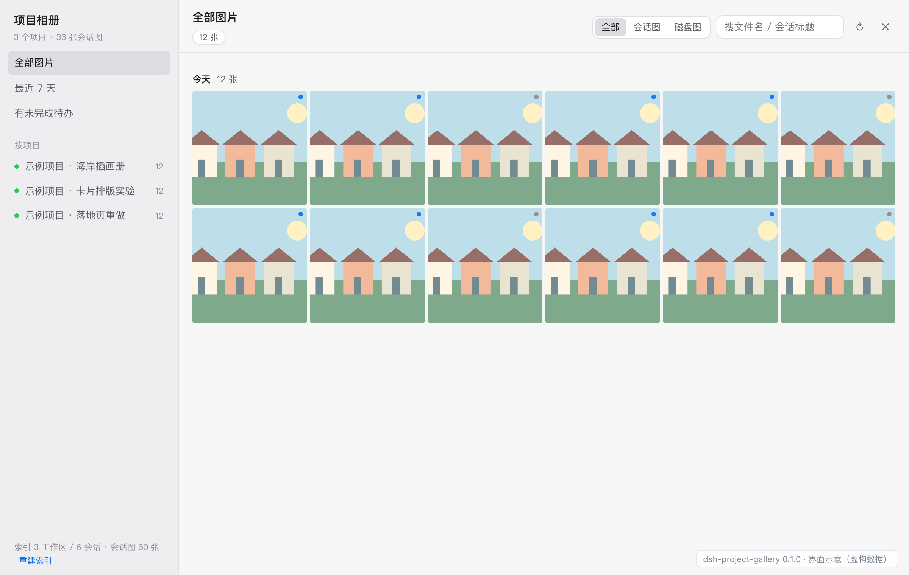
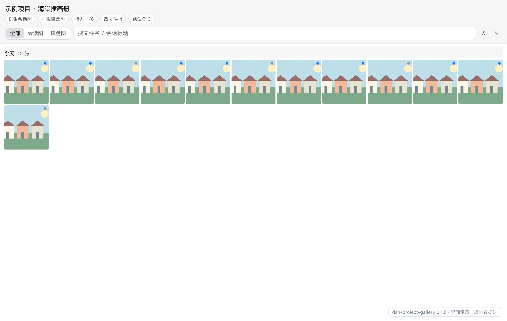
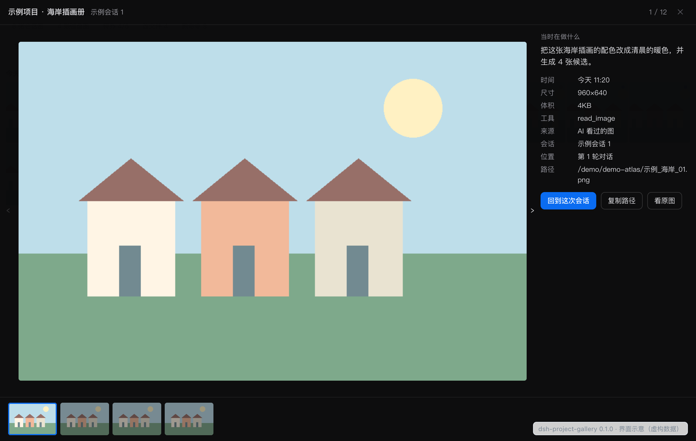

# 项目相册 · dsh-project-gallery

DeepSeek Harness（DSH）插件：把会话里 AI 看过 / 生成过 / 交付过的图，以及项目目录里的图，**按项目攒成一册**。
悬停项目行就能看最近几张；点开是相册；点大图能看到**当时你让它做什么**。







> 以上三张是**虚构数据的界面示意**（`npm run shots` 生成，水印在右下角），不含任何真实项目或会话。来源见
> [docs/screenshots-demo/PROVENANCE.md](docs/screenshots-demo/PROVENANCE.md)。

## 三个入口

| 位置 | 打开什么 |
|---|---|
| 悬停项目 / 对话行**右侧的 ⋯ 区** | 弹一张小卡：项目名 + 「N 张图 · 待办 x/y」+ 2×2 缩略图，可 📌 固定、可 ⊘ 静音该项目 |
| 卡片里「打开相册」/ 点缩略图 | 右侧面板（420px）：按天分组的网格 + 搜索 + 会话图/磁盘图切换 |
| 工作区头部 **📷** 或 **⌘⇧G** | 全局相册浮层：左侧按项目、右侧按天网格 |

## 灯箱

大图**不再铺满屏幕**：图在左、上下文在右（当时在做什么、时间/尺寸/体积/工具/来源/会话/第几轮/路径）、
同会话的图在底部排成胶片条，`←/→` 翻页、`Esc` 逐层退回对话。显示用 1600px 中图秒开，想看原始像素点「看原图」。

## 数据从哪来

- 会话附件：`~/.dsh/sessions/**/session.v4.jsonl.zstd` + `~/.dsh/attachments/v1/objects/**`
- 交付图：`deliverables/presented`
- 项目目录里的图：限深 3、跳过 `node_modules/.git/dist`、近 240 天、单张 ≤30MB

**读的全是本机文件，不发任何网络请求**（除了插件自己的本地接口）。

## 隐私

- 索引与缩略图缓存在本机（默认 `~/.dsh/cache/dsh-session-gallery`），含**项目路径、会话标题、对话文字**；
  分享缓存目录前请自行检查。
- 静音设置存在浏览器 localStorage（`dsh-project-gallery:muted`），不上传。
- 插件不收集遥测。

## 安装

```sh
# 从本地目录装进指定 profile（DSH 还没发布到市场时可用这个）
node scripts/install.mjs --profile desktop
```

或 `dsh plugin --profile <name> add ./`（具体以你的 DSH 版本为准）。

## 开发

```sh
npm run check          # 语法 + 15 项单测
npm run shots          # 重新生成演示图（需要 playwright）
```

## 已知限制

- 悬停预览依赖宿主 DOM（`data-row-key`）与几何推断，DSH 大版本升级后可能需要重新对位；取不到就只剩「📷 全盘相册」。
- 搜索结果里的会话行没有 `data-row-key`，悬停不生效，请用全局相册。
- 同一张图出现在多个会话时，各会话各自保留一条关联（这是真实状态，不做跨会话合并）。

## License

MIT
