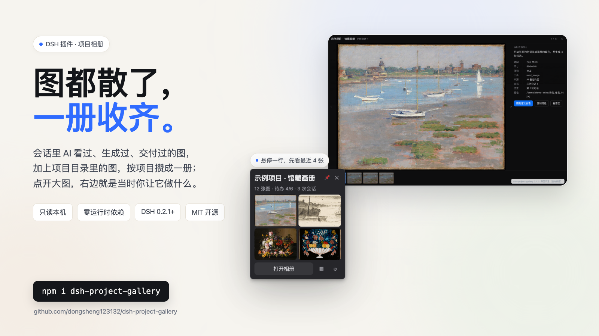
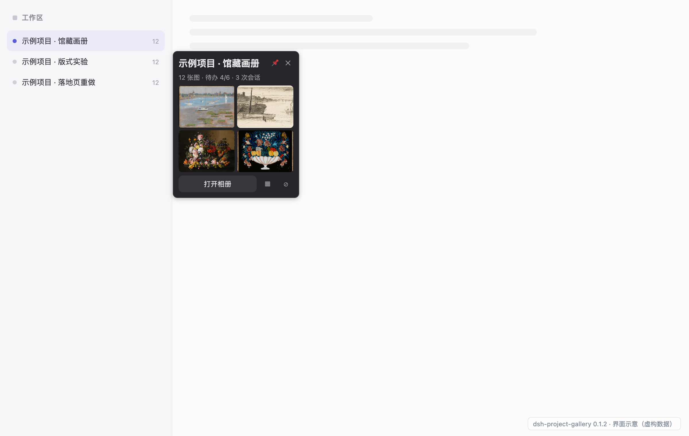

# 项目相册 · dsh-project-gallery

<p align="center">
  <a href="https://www.npmjs.com/package/dsh-project-gallery"></a>
  <a href="https://www.npmjs.com/package/dsh-project-gallery"></a>
  
  
</p>

[English](README.en.md) · **中文**


DeepSeek Harness（DSH）插件：把会话里 AI 看过 / 生成过 / 交付过的图，以及项目目录里的图，**按项目攒成一册**。
悬停项目行就能看最近几张；点开是相册；点大图能看到**当时你让它做什么**。



## 三个入口

| 位置 | 打开什么 |
|---|---|
| 悬停项目 / 对话行**右侧的 ⋯ 区** | 弹一张小卡：项目名 + 「N 张图 · 待办 x/y」+ 2×2 缩略图，可 📌 固定、可 ⊘ 静音该项目 |
| 卡片里「打开相册」/ 点缩略图 | 右侧面板（420px）：按天分组的网格 + 搜索 + 会话图/磁盘图切换 |
| 工作区头部 **📷** 或 **⌘⇧G** | 全局相册浮层：左侧按项目、右侧按天网格 |



## 灯箱

大图**不再铺满屏幕**：图在左、上下文在右（当时在做什么、时间/尺寸/体积/工具/来源/会话/第几轮/路径）、
同会话的图在底部排成胶片条，`←/→` 翻页、`Esc` 逐层退回对话。显示用 1600px 中图秒开，想看原始像素点「看原图」。


> 截图与促销图都用**虚构数据**生成（`node demo/shots.mjs`、`node promotion/make-promo.mjs`）；演示图片是公共领域作品
> （Met Open Access，CC0，来源见 [demo/fixtures/LICENSE-IMAGES.md](https://github.com/dongsheng123132/dsh-project-gallery/blob/main/demo/fixtures/LICENSE-IMAGES.md)），不含任何真实项目或会话。
> 重生成步骤与逐图来源见 [docs/screenshots-demo/PROVENANCE.md](https://github.com/dongsheng123132/dsh-project-gallery/blob/main/docs/screenshots-demo/PROVENANCE.md)。

## 数据从哪来

- 会话附件：`~/.dsh/sessions/**/session.v4.jsonl.zstd` + `~/.dsh/attachments/v1/objects/**`
- 交付图：`deliverables/presented`
- 项目目录里的图：限深 3、跳过 `node_modules/.git/dist`、近 240 天、单张 ≤30MB

**读的全是本机文件，不发任何网络请求**（除了插件自己的本地接口）。

## 隐私

- 索引与缩略图缓存在本机（默认 `~/.dsh/cache/dsh-session-gallery`），含**项目路径、会话标题、对话文字**；
  分享缓存目录前请自行检查。
- 静音设置存在浏览器 localStorage（`dsh-project-gallery:muted`），不上传。
- 插件不收集遥测。

## 安装

DSH 桌面版：**设置 → 插件 → 添加插件**，填 `dsh-project-gallery`。

或者命令行：

```sh
dsh plugin --profile <你的 profile> add dsh-project-gallery
```

想比 npm 版更新（跟 main 走）：

```sh
dsh plugin --profile <你的 profile> add github:dongsheng123132/dsh-project-gallery
```

clone 本仓库后本地装：`node scripts/install.mjs --profile desktop`。

装好后重启 DSH，左侧工具区会出现入口（不同 DSH 版本位置略有差异）。

## 在 DSH 插件市场里搜到它

本仓库根目录的 `plugin-index.json` 就是一条插件市场索引源，不用起服务：

```
https://raw.githubusercontent.com/dongsheng123132/dsh-project-gallery/main/plugin-index.json
```

在 DSH 里启用实验性插件市场 → 把上面这个地址添加为索引源 → 搜「项目相册」或 `project gallery`。

## 开发

```sh
npm run check          # 语法 + 21 项单测（含宿主半片降级 6 项）
npm run shots          # 重新生成演示图（需要 playwright）
```

## 它贴宿主贴得多紧

这个插件不是只加一行菜单：它挂一个 `/session-gallery` 前缀路由、读宿主的工作区注册表、还要在侧栏 DOM 上做悬停几何识别。
宿主缺哪块就降级哪块（没注册表 → 悬停失效但全局相册照用；没 `connection` → 跳过鉴权判定但保留同源检查），
细节与**宿主求值器实测表**（0.2.1-rc.5 → 0.3.0 全部放行）见 [COMPATIBILITY.md](COMPATIBILITY.md)。

实用口径：`engines.dsh` 只写下界、不写上界——上界会让 DSH 一升级就直接装不上，而不是降级。

## 已知限制

- 悬停预览依赖宿主 DOM（`data-row-key`）与几何推断，DSH 大版本升级后可能需要重新对位；取不到就只剩「📷 全盘相册」。
- 目前只在 macOS 上实测（CLI 0.2.2-rc.1 / 桌面版 0.2.2-rc.3）；Windows 桌面版未验证。
- 搜索结果里的会话行没有 `data-row-key`，悬停不生效，请用全局相册。
- 同一张图出现在多个会话时，各会话各自保留一条关联（这是真实状态，不做跨会话合并）。

## License

MIT
